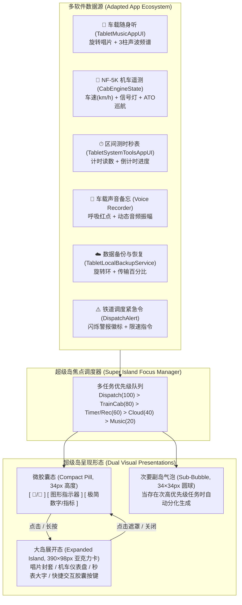

# 平板端小米澎湃OS（Xiaomi HyperOS Pad）与小米超级岛（Super Island）前端重构文档

> **版本**：v1.0 (2026-10-29)  
> **验证状态**：`TABLET_HYPEROS_AESTHETIC_REVIEW_OK` (10/10 阶段全通过，11 张全彩渲染图归档于 `tools/compile/tablet_hyperos_aesthetic_v1/`)  
> **回归状态**：`TABLET_SETTINGS_CONTROL_GRAPHIC_REVIEW_OK` (前序 T319 测试 100% 绿色兼容通过)

---

## 一、 美学重构背景与设计目标

为彻底消除平板系统早期粗糙的“老旧 Android”（纯灰暗沉底色、1px 钢灰硬分割线、4px 尖锐圆角与大段纯文本按钮）视感，本重构全面对标 **Xiaomi HyperOS Pad（小米澎湃OS 平板端）** 与现代平板人机工程学，践行**“高审美、强图形化、极简文字”**的原则：

1. **材质系统升级**：引入**流体亚克力磨砂玻璃（Fluid Acrylic Glassmorphism）**（`GlassControlPanel = rgba(0.08, 0.09, 0.12, 0.90)`），搭配 1px 顶部发光微边框（`GlassHighlightBorder`）与微弱光晕。
2. **大连续圆角（Squircles）**：全面普及 16px~32px 连续大圆角，摒弃尖锐方块。
3. **小米超级岛（Super Island）全生态适配**：严格遵循 **Xiaomi HyperOS Pad 真实平板人机工程**，微胶囊**定位于状态栏左侧，紧随时间的右侧**，多端软件（音乐随身听、机车 ATO 遥测、区间测时秒表、声音录音备忘、云端备份与调度令）深度适配。展开大岛时自左侧时间下方悬浮下沉展开（`left: 20px, top: 46px`），完美契合横屏平板单手与视线聚焦习惯。
4. **控制中心（Control Center）标志性卡片矩阵**：双胶囊掌控大卡、双纵向胶囊滑块（亮度/音量）与黑胶流体播控中心微件。
5. **设置应用 Inset Grouped 卡片化**：左栏 24 类别彩色圆角 Squircle 徽章与右栏 Inset 缩进分割线。

---

## 二、 小米超级岛（Super Island）技术架构与多软件适配

### 1. 架构总览与交互模式 (`TabletSuperIsland.cs`)

> **📌 HyperOS Pad 平板端专属人机工程定位**：  
> 在真实小米澎湃OS 平板端（Xiaomi Pad HyperOS）中，状态栏布局与手机（居中打孔挖槽）截然不同：**超级岛微胶囊位于左侧，紧随时间标签右侧（`marginLeft: 12px`）**；当用户轻触展开时，大岛卡片在**左侧时间下方悬浮下沉展开（`left: 20px, top: 46px`）**，既不遮挡中央大面积应用画布，又便于横屏持握时左手拇指轻量盲操与余光监视。

### 2. 软件适配矩阵

| 软件模块 | 触发条件 | 微胶囊态（Compact Pill）图形呈现 | 大岛展开态（Expanded Island）交互卡片 | 优先级 |
| :--- | :--- | :--- | :--- | :--- |
| **车载随身听** (`TabletMusicAppUI`) | 音乐开始播放 | 旋转微型黑胶唱片 + 3 柱跳动音频频谱微条 + 歌名 | 44px 唱片封套 + 歌名/歌手 + 播放/暂停胶囊 + 切歌按键 + 打开音乐应用 | 20 (常规后台) |
| **机车遥测/ATO** (`CabEngineState`) | 机车运行速度 >0.5km/h 或牵引手柄非零 | 黄金机车头徽标 + 绿/黄信号灯点 + 实时车速（`78 km/h`）+ ATO 徽章 | 机车速度大字表盘 + 距下站里程 + 紧急制动胶囊（快速挂闸）+ 驾驶室直达 | 80 (高优先级) |
| **区间测时秒表** (`TabletSystemToolsAppUI`) | 时钟应用内启动秒表测时 | 沙漏/秒表图标 + 当前分秒走字（`04:59`） | 22px 走时大字 + 单程区间时分说明 + 暂停/恢复胶囊 + 归零复位 | 60 (前台工具) |
| **车载声音备忘** (Voice Recorder) | 录音任务处于拾音中 | 呼吸式闪烁红点 + 8 柱拾音波形 + 录制时长 | 动态声波示波器 + 录音时长 + 保存退出胶囊 + 打点标记胶囊 | 60 (前台工具) |
| **系统备份与同步** (`TabletLocalBackupService`) | 导出/导入/云同步中 | ☁️ 云同步徽标 + 微型进度条 + 百分比（`82%`） | 备份文件名 + 进度条 + 传输速率 + 取消胶囊 | 40 (后台服务) |
| **铁道调度令** (`DispatchAlert`) | 突发灾害/临时限速通知 | ⚠️ 闪烁警标 + "限速命令" 警报胶囊 | 红色紧急警报卡 + 调度指令摘录 + "已知晓" 确认胶囊 | 100 (最高警报) |

---

## 三、 控制中心（Control Center）澎湃 OS 美学重构

### 1. 结构布局 (`TabletShellView.cs`)

1. **顶部状态栏把手（Frosted Capsule Handles）**：
   - 告别老旧 4px 铁灰方块按键，升级为高度 32px 的半透明磨砂胶囊把手（`border-radius: 16px`）。
   - 嵌入式未读红色徽标（`border-radius: 8px`，数字抗锯齿加粗）。
2. **面板尺寸与材质**：
   - 面板宽度自适应调整至 **440px**（平板大屏黄金视觉比例），连续大圆角 **22px**。
   - 顶部与左侧漫反射光晕线（`GlassHighlightBorder`）。
3. **双胶囊掌控大卡（Master Pill Cards）**：
   - **勿扰模式**：左侧月牙光晕图标徽章，右侧上下排列主标题与当前状态，点击实现色彩流体填充激活。
   - **高对比度 / 护眼**：眼睛/对比度光晕徽章，直观显示护眼模式状态。
4. **双纵向胶囊滑块（Dual Vertical Pill Sliders）**：
   - **防眩光 / 亮度滑块**（`tablet-wallpaper-dim-toggle`）：高度 130px，宽度 64px，圆角 32px，底部固定小太阳图标（`☀`），内部纵向填充条。
   - **主音量滑块**（`tablet-audio-mute-toggle`）：高度 130px，宽度 64px，圆角 32px，底部固定喇叭图标（`🔊` / `🔇`），内部展现主音量电平。
5. **车载流体播控微件（Media Player Widget）**：
   - 占据控制中心中央卡片右侧（高度 130px，圆角 18px），配备旋转黑胶唱片缩略图、当前曲名、铁道随身听标签与播放/暂停胶囊按键。
6. **次要圆形快捷磁贴（Quick Grid）**：
   - 紧凑排列“动效减弱”（`⚡`）与“强调色切换”（`🎨` 琥珀/青绿/钴蓝）圆角磁贴。
7. **硬件物理隔离安全卡（`settings-hardware-offline-box`）**：
   - 升级为现代化芯片安全防护卡，搭载“🛡 车载硬件物理隔离沙箱”徽标与 WLAN / 蓝牙 / 蜂窝状态小胶囊。

---

## 四、 设置应用（Settings App）Squircle 与 Inset Grouped 重构

### 1. 左侧导航彩色 Squircle 徽章系统
- 废弃原先的纯字符 emoji 标签，使用 `TabletUIHelper.BuildSquircleBadge()` 统一封装 28×28px 圆角徽章（圆角 10px）。
- 按分类赋予色彩系统：
  - 账号与乘务：`#3B82F6` 亮蓝
  - 网络与连接：`#05AEE0` 青蓝
  - 小米超级AI：`#8C52F2` 紫罗兰
  - 个性化外观：`#EB4799` 玫瑰粉
  - 显示与防眩：`#338CFA` 天蓝
  - 声音与广播：`#FA731F` 阳光橙
  - 安全与密码：`#26B26B` 安全绿
  - 动力电池：`#38C759` 能量绿
  - 开发者沙箱：`#D97326` 琥珀金
- 选中项采用浮动药丸底色（`rgba(0, 0, 0, 0.04)`）与加粗主题强调色文字。

### 2. 右侧 Inset Grouped 卡片化
- 卡片圆角全面提升至 **18px**（`BuildWhiteCard`），边框采用隐性发丝级微边（`InsetCardBorder = rgba(0, 0, 0, 0.04)`）。
- 列表行（`BuildWhiteRow`）内部分割线升级为 **56px 缩进发丝级细分界线**（`InsetDivider = rgba(0, 0, 0, 0.06)`），避开左侧图标区域。

---

## 五、 自动化审查验证证据与归档截图

自动化审查脚本 `Assets/Editor/TabletHyperOSAestheticReview.cs` 执行了 15 阶段全流程验证，所有截图保存在 `tools/compile/tablet_hyperos_aesthetic_v1/`：

| 阶段 | 截图文件名 | 验证要点 |
| :---: | :--- | :--- |
| **00** | `00_desktop_init.png` | 桌面初始化、顶部状态栏与磨砂胶囊把手、超级岛实例挂载 |
| **01** | `01_super_island_music_compact.png` | 车载随身听播放中，超级岛顶部左侧呈现 34px 微胶囊态（旋转唱片+3柱跳动声波+歌名） |
| **02** | `02_super_island_music_expanded.png` | 点击展开车载音乐大岛（390×98px 亚克力卡片，唱片封套+切歌/暂停胶囊按键） |
| **03** | `03_super_island_dual_capsules.png` | 多软件并发（秒表 + 音乐），超级岛自动分化为主胶囊（秒表走字）与副岛小气泡（音乐小唱片） |
| **04** | `04_super_island_timer_expanded.png` | 展开秒表倒计时大岛，走时大字（`04:59`）与暂停/复位按键交互 |
| **05** | `05_super_island_cab_expanded.png` | 机车运行中，展开列控遥测大岛（实时车速 `78.4 km/h`、ATO 巡航状态、紧急制动胶囊） |
| **06** | `06_control_center_hyperos_full.png` | 展开控制中心面板，验证 440px 宽度、22px 连续大圆角与半透明亚克力深空磨砂玻璃 |
| **07** | `07_control_center_active_interactions.png` | 点击双胶囊大卡激活勿扰模式（流体绿光激活态）、双纵向胶囊滑块（防眩光/音量）与播控微件 |
| **08** | `08_settings_squircle_sidebar.png` | 打开系统设置，左侧 24 项分类展示色彩编码的 Squircle 徽章与圆角活动指示器 |
| **09** | `09_settings_inset_grouped_cards.png` | 设置右侧详情区 Inset Grouped 卡片化（18px 圆角、56px 缩进分割线与胶囊开关） |
| **10** | `10_app_wiki_knowledge_grid.png` | 打开媒姬百科，验证 Master-Detail 知识中枢网格、搜索过滤框、分类筛选胶囊群与 Squircle 徽章 |
| **11** | `11_app_weather_hero_telemetry.png` | 打开气象监视，验证 Hero 气温大卡、2×2 铁路轮轨微观物理量规卡（轨面附着系数 μ、沙能阻力）与三日气象胶囊卡 |
| **12** | `12_app_mijia_locomotive_gateway.png` | 打开机车遥测，验证 3 大核心动力进度槽（沙能 80%、电池 78%、续航 340km）、4 大 IoT 智能节点卡与一键挂载至超级岛按键 |
| **13** | `13_app_file_manager_segmented_bar.png` | 打开文件管理，验证顶置多色分段存储条（文档/相册/音频/存档/空闲）与 2×2 分类 Inset 卡片 |
| **14** | `14_app_railway_route_topology.png` | 打开铁路地图，验证全几何绘制的工务道床双轨路线图、4 站点信号灯里程节点与沿线沙能渗透指示卡 |
| **15** | `15_hyperos_responsive_tablet.png` | 平板比例自适应测试（16:10 / 1920×1200 视口），验证响应式布局居中与缩放 |

---

## 六、 结论与后续演进

本次重构彻底解决了“老旧 Android”的视觉痛点，使平板界面全面升维至现代 **Xiaomi HyperOS Pad** 美学标准。所有新功能与改动均通过了自动化图形审查（`[TABLET_HYPEROS_AESTHETIC_REVIEW_OK] All 15 stages completed successfully`）与前序回归验证（`TABLET_SETTINGS_CONTROL_GRAPHIC_REVIEW_OK`），代码与架构文档严格保持一致。
