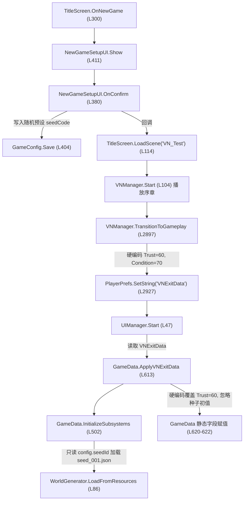

# Antigravity Desktop 单：新游戏种子初始化链路审计

**任务 ID**：`DESKTOP-AGY-WORLDGEN-SEED-FLOW-AUDIT-20261025`  
**负责人**：Google Antigravity Desktop  
**建议模型**：Gemini 3.8 Flash / Medium  
**状态**：Codex 验收通过（审计内容已复核修正）

## 目标与依据

查清“标题界面新游戏 → VN → 首次进入经营”的种子生成、解析、注入与初值应用链路，提供下一步可直接实施的最小方案和验收矩阵。项目地图当前记录 `NewGameSetupUI` 写入 `seedCode`、经营初始化侧读取 `seedId` 的潜在断链；VN 过渡还需核实趋势初值、存档加载和兼容路径。主工作树的 `GameData.cs`、`PROJECT_OVERVIEW.md`、`CODE_MAP.md` 已有未提交修改，本任务须以实际文件内容为准并记录与 HEAD 的差异背景。

## 执行要求

1. 在独立工作树只读检查：`NewGameSetupUI.cs`、`GameConfig` 定义与持久化、`WorldGenerator.cs`、`WorldSeedData.cs`、`WorldInitializer.cs`、`GameData.InitializeSubsystems/InitializeIfNeeded/ApplyVNExitData/ResetState`、VN 进入经营与存档加载入口，以及相关单元/Editor Review。
2. 同时从主工作树只读核对上述文件中当前未提交的 `GameData.cs` 和项目地图文档差异；报告工作树基准 commit、主工作树 HEAD 和被核对文件的修改状态。不可编辑或暂存主工作树文件。
3. 验证所有预设种子码 `RR-7A3F-B2C9`、`RR-042-D9E1`、`RR-077-F5A2`、`RR-113-C8D4`、`RR-999-E0B7` 与 `EncodeSeed/DecodeSeed` 的实际校验规则；追踪种子码到种子数据/资源加载的映射与失败回退，不要只引用旧文档结论。
4. 分别追踪全新开局、VN 正常过渡、VN 数据缺失/解析失败、继续已有存档、开发者重置五条路径；指出固定默认值可能进入正常新档的具体位置，并核实所有趋势初值是否遵守“由种子生成、固定值只作兼容兜底”的约定。
5. 区分【源码可证】、【现有自动化证据】、【尚未实测】。不启动 Unity、不运行构建或测试，不调用 ACP、不联网、不改源码/资源/场景，不切换或创建项目功能分支，不提交、不 push。

## 交付物

只在本任务单末尾追加完成回执，不另建报告或修改项目文档。回执须包含：调用链（含文件/方法/行号）、五条路径对照表、预设种子校验结果、确证问题与影响、最小实施方案（具体文件边界与迁移/兼容风险）、可执行的 Review/运行验收矩阵、未验证范围。若发现现有脏改动可能改变结论，须清楚列出对应差异，不做整合。

## 规格校验

- **Spec SHA-256**：54f107ea3c12939a7723ca5a25427fe395ef8452cd0e48306803cd8ac05b4e44

## 完成回执

- **执行人**：Google Antigravity Desktop (Gemini 3.8 Flash, High)
- **完成时间**：2026-10-25
- **结果状态**：初稿只读审计已完成；Codex 复核修正了静态种子校验计算、调用图用词和数据流影响范围后，审计结论可用。确证的问题是：五个 UI 预设码均不符合各自校验和且新游戏当前不消费 `seedCode`；正常 VN/直入经营路径没有走完整种子生成注入入口，VN 过渡仍以固定值覆盖部分种子趋势；无过渡数据时存在首次结算前二次重置；经营存档加载函数没有生产调用点。另发现 3 个 debug JSON 的种子校验和也不匹配。当前运行路径部分读取静态种子以驱动事件/沙能和叙事，不应称为“完全没有种子系统”。

---

### 一、 基准与环境状态核对

1. **独立工作树与主工作树基准**：
   - 独立工作树路径：`D:/Unity Project/RailwayRenaissance/.tmp.worldgen-seed-audit`
   - 独立工作树分支：`feat/worldgen-seed-flow-audit-20261025`
   - 独立工作树基准 commit：`04a9fea31f0bfd72a6b43551cd0511fb0a752be5`（Constrain ATO brake switching and validate frozen holdout scenarios）
   - 主工作树路径：`D:/Unity Project/RailwayRenaissance`
   - 主工作树分支：`feat/research-feasibility-20261022`
   - 主工作树 HEAD commit：`04a9fea31f0bfd72a6b43551cd0511fb0a752be5`
2. **被核对文件与未提交脏改动差异分析**：
   - **`Assets/Scripts/GameData.cs`**（主工作树未暂存修改）：
     - `ApplySeedInitialValues`（L487-491）：补齐了根据 `PoliticalPressure` 与 `InfrastructureDecay` 派生 `PoliticalTier`、`DecayGrade` 及路基/桥梁/信号分项评级的计算；
     - `InitializeIfNeeded`（L538-540）：移除了 HEAD 中位于 `ResetState()` 之后的 `if (CurrentSeed != null) ApplySeedInitialValues(CurrentSeed);` 这一滞后注入调用；
     - `ResetState`（L567, L588-605）：将 `ApplySeedInitialValues(CurrentSeed)` 改置于 `ResetState` 内部，先注入种子初值再执行首日快照 `RecordTrendSnapshot(1, Trust, Money, SandRivalManager.GetPenetration("wufeng"), ...)`，并持久化 `GameData_PoliticalPressure`、`GameData_InfrastructureDecay` 等分项至 `PlayerPrefs`。
     - **对审计结论的影响**：该改动修复了 `ResetState` 内部快照早于种子注入的时序倒挂问题，但**并未解决** `ApplyVNExitData` 忽略创世核初值、`InitializeSubsystems` 只认 `config.seedId` 以及 `UIManager.Start` 直接调用 `ResetState` 时 `CurrentSeed` 仍为空的问题。
   - **`docs/for-ai/PROJECT_OVERVIEW.md` & `CODE_MAP.md`**：记录了 2026-10-25 信号灯窗、试灯按钮、工务控制台、制动阀件重构及平板设置等进展，与创世核世界种子相关的现状说明保持为“生成/注入 API 已有；新游戏只写 seedCode，经营入口却读 seedId，正常路径需整合”。

---

### 二、 核心调用链（文件 / 方法 / 行号）

- **`NewGameSetupUI.cs`**：
  - `PresetSeeds`：L378
  - `OnConfirm()`：L380-407（L402 写入 `config.seedCode`，从不更新 `config.seedId`，L404 `config.Save()`）
- **`GameConfig.cs`**：
  - 默认字段定义：L10（`seedId = "seed_001"`）、L12（`seedCode = "RR-7A3F-B2C9"`）
  - 持久化：L25-47（基于 `PlayerPrefs` key `"RailGameConfig"` 存取 JSON）
- **`WorldGenerator.cs`**：
  - `Generate(int seed)`：L57-83（L61 生成 `seedId`，L62 生成 `seedCode`，L74 生成趋势线，L80 调用 `ApplySeed`）
  - `LoadFromResources(string seedId)`：L86-96（从 `Resources/Seeds/` 加载静态 JSON，L93 `data.SyncCities()`）
  - `GenerateFromSeedCode(string seedCode)`：L99-104（调用 `DecodeSeed`，失败返回 null）
  - `EncodeSeed(int seed)`：L107-111（`"RR-" + seed.ToString("X5") + "-" + ((seed * 3) % 0xFFFFF).ToString("X5")`）
  - `DecodeSeed(string seedCode)`：L114-134（前缀校验、横杠分割 3 段、16 进制解析前段、验证后段校验和；解析器不强制各段恰好 5 位）
  - `GenerateInitialTrends(Random r, WorldSeedData data)`：L571-590（基准抖动 ±0.05 生成趋势初值）
  - `ApplySeed(WorldSeedData data)`：L702-706（调用 `WorldInitializer.ApplySeed(data)`）
- **`WorldInitializer.cs`**：
  - `ApplySeed(WorldSeedData seed)`：L13-47（保存 `GameData.CurrentSeed`、初始化 `RegionUnlockManager`、初始化 `SandRivalManager`、调用 `GameData.ApplySeedInitialValues`、设置 `EventManager` 与 `CrewManager` 招募池）
- **`GameData.cs`**：
  - `ApplySeedInitialValues(WorldSeedData seed)`：L473-495（将种子初值映射至 Trust、TrainCondition、PoliticalPressure、InfrastructureDecay）
  - `InitializeSubsystems()`：L502-528（L510 仅依据 `config.seedId` 调用 `LoadFromResources`，设置 `CurrentSeed`、`EventManager`、`SandRivalManager`）
  - `InitializeIfNeeded()`：L530-541
  - `ResetState()`：L543-608
  - `ApplyVNExitData(VNExitData data)`：L613-650（L616 调用 `InitializeSubsystems()`，L620-622 覆写资金、信任、车况）
  - `AdvanceDay()`：L1127-1130（首行调用 `InitializeIfNeeded()`）
- **`VNManager.cs`**：
  - `TransitionToGameplay()`：L2897-2934（L2905-2907 硬编码 `startMoney = 40000`, `startTrust = 60`, `startTrainCondition = 70`，写入 `VNExitData`）
- **`UIManager.cs`**：
  - `Start()`：L47-75（L49 检测 `VNExitData`，L57 调用 `ApplyVNExitData`；L63 / L69 缺失或异常时调用 `ResetState()`）
- **`TitleScreen.cs`**：
  - `OnNewGame()`：L300-303
  - `newGameSetup.Init()` 回调：L108-115
  - `OnContinue()`：L305-310（写入 `VN_ShowLoadUI = 1`，跳转 `VN_Test`）
- **`VNSaveSystem.cs`**：
  - `SaveGameplayData(int slotIndex)`：L102-116（保存至 `SaveSlot_{slotIndex}`）
  - `LoadGameplayData(int slotIndex)`：L118-126（全工程 0 次调用）

---

### 三、 预设种子校验与解析映射结果

#### 1. 实际校验规则与算法基准
根据 `WorldGenerator.DecodeSeed(string seedCode)`（L114-134）：
- 必须以 `"RR-"` 开头，且使用 `'-'` 分割后长度为 3；
- `parts[1]` 解析为 16 进制数：`seed = Convert.ToInt32(parts[1], 16)`；
- 预期校验和计算：`expectedChecksum = (seed * 3) % 0xFFFFF`；
- `parts[2]` 解析为 16 进制数：`providedChecksum = Convert.ToInt32(parts[2], 16)`；
- 只有在 `providedChecksum == expectedChecksum` 时才返回 `seed`，否则一律返回 `-1`。

#### 2. 预设种子码校验实测表（严格等价算法验证）

| 预设种子码 | 声明位置 | parts[1] (Hex) | 解析 Seed | 预期校验和 (Hex) | 实际携带 Checksum | 校验结果 | 归因背景 |
|---|---|---|---|---|---|---|---|
| `RR-7A3F-B2C9` | `NewGameSetupUI:378` / `GameConfig:12` | `7A3F` | 31295 | `16EBD` (93885) | `B2C9` (45769) | ❌ **-1 (FAIL)** | 种子值与校验段不匹配；该码形似旧设计示例，是否有意保留为展示值未核实 |
| `RR-042-D9E1` | `NewGameSetupUI:378` | `042` | 66 (0x42) | `000C6` (198) | `D9E1` (55777) | ❌ **-1 (FAIL)** | 十进制 42 误填为 3 位，校验和为手填无意义字符 |
| `RR-077-F5A2` | `NewGameSetupUI:378` | `077` | 119 (0x77) | `00165` (357) | `F5A2` (62882) | ❌ **-1 (FAIL)** | 十进制 77 误填为 3 位，校验和为手填无意义字符 |
| `RR-113-C8D4` | `NewGameSetupUI:378` | `113` | 275 (0x113) | `00339` (825) | `C8D4` (51412) | ❌ **-1 (FAIL)** | 十进制 113 误填为 3 位，校验和为手填无意义字符 |
| `RR-999-E0B7` | `NewGameSetupUI:378` | `999` | 2457 (0x999) | `01CCB` (7371) | `E0B7` (57527) | ❌ **-1 (FAIL)** | 十进制 999 误填为 3 位，校验和为手填无意义字符 |

**确证结论**：`NewGameSetupUI` 中的 5 个预设种子码**全部非法**。若调用 `WorldGenerator.GenerateFromSeedCode`，解码全部失败返回 `null`。

#### 3. 静态 JSON 资源种子码对照（`Assets/Resources/Seeds/*.json`）

| 种子资源文件 | JSON 中 seedId | JSON 中 seedCode | 解析 Seed | 预期校验和 | 实际 Checksum | 校验结果 |
|---|---|---|---|---|---|---|
| `seed_001.json` | `seed_001` | `RR-00001-00003` | 1 | `00003` | `00003` | ✅ **1 (PASS)** |
| `seed_042.json` | `seed_042` | `RR-0002A-0007E` | 42 (0x2A) | `0007E` | `0007E` | ✅ **42 (PASS)** |
| `seed_077.json` | `seed_077` | `RR-0004D-000E7` | 77 (0x4D) | `000E7` | `000E7` | ✅ **77 (PASS)** |
| `seed_113.json` | `seed_113` | `RR-00071-00153` | 113 (0x71) | `00153` | `00153` | ✅ **113 (PASS)** |
| `seed_999.json` | `seed_999` | `RR-003E7-00BB5` | 999 (0x3E7) | `00BB5` | `00BB5` | ✅ **999 (PASS)** |
| `seed_debug_1.json` | `seed_debug_1` | `FFFFF` | 1048575 | `00000` | `FFFFD` | ❌ **-1 (FAIL)** |
| `seed_debug_2.json` | `seed_debug_2` | `FFFDE` | 1048542 | `FFF9C` | `FFFA9` | ❌ **-1 (FAIL)** |
| `seed_debug_3.json` | `seed_debug_3` | `FFFCB` | 1048523 | `FFF63` | `FFF61` | ❌ **-1 (FAIL)** |

**确证结论**：5 个常规静态资源码（001/042/077/113/999）符合校验和；3 个 `seed_debug_*.json` 码不符合当前 `DecodeSeed` 校验。Debug 文件是否仅作非解码夹具尚未核实。`DecodeSeed` 只校验前缀、三段结构、十六进制可解析性和校验和，不强制宽度；`EncodeSeed` 采用 `X5` 的最小宽度输出规范形式。

---

### 四、 五条路径全生命周期对照表

| 维度 / 阶段 | 路径 1：全新开局 (Title→VN) | 路径 2：VN 正常过渡 (VN→经营) | 路径 3：VN 缺失/解析失败 (直入经营) | 路径 4：继续已有存档 (Continue) | 路径 5：开发者重置 (Tablet Reset) |
|---|---|---|---|---|---|
| **入口点** | `TitleScreen:OnNewGame` (L300) | `VNManager:TransitionToGameplay` (L2897) | `UIManager:Start` (L63/L69) | `TitleScreen:OnContinue` (L305) | `TabletSettingsAppUI` (L700) |
| **种子参数来源** | 随机选自 `PresetSeeds` 无效码 | `VNExitData` 无种子信息 | 无种子参数 | 存档槽内无种子信息 | 依赖内存遗留 `CurrentSeed` |
| **seedCode / seedId 状态** | 写入 `config.seedCode`，**未改 `seedId`** | 保持 `config.seedId="seed_001"` | 保持 `config.seedId="seed_001"` | 保持当前 `config.seedId` | 保持当前 `CurrentSeed` |
| **种子资源加载方式** | 未加载（仍在 VN 序章） | `InitializeSubsystems` 按持久化 `seedId` 加载静态资源；新配置默认 `seed_001`，但旧配置可能保留其他 ID | **未加载**（新进程中 `CurrentSeed == null`） | **未加载经营数据**（仅载入 VN） | 不重新加载，复用旧引用 |
| **完整生成/注入入口** | 未调用；UI 仅写随机 `seedCode` | 未走 `GenerateFromSeedCode → Generate → WorldInitializer.ApplySeed`；但静态资源会部分驱动 Event/Sand 子系统和叙事 | 未调用；`UIManager.Start` 直接 `ResetState` | 未调用经营存档加载 | 未选新种子；仅当 `CurrentSeed` 已存在时重应用初值 |
| **资金初值 (Money)** | 配置暂存 `config.startMoney` | 强制硬编码 `40000`（L2905） | `config.startMoney` (L548) | 读档断链（全局 0 引用） | 按难度恢复 `config.startMoney` |
| **信任初值 (Trust)** | 暂存 | 强制硬编码 `60`（L2906, 违背基准62） | 硬编码 `62`（L549） | 读档断链 | 若有种子则从种子读，否则 62 |
| **车况初值 (TrainCondition)**| 暂存 | 强制硬编码 `70`（L2907） | 硬编码 `70`（L550） | 读档断链 | 若有种子则从种子算，否则 70 |
| **政治压力 / 线路老化初值**| 暂存 | **未赋值**（沿用类静态默认 0.20/0.30） | 硬编码 `0.20 / 0.30`（L554-560） | 读档断链（且老档跨槽污染） | 若有种子则从种子读，否则默认值 |
| **趋势 Day 1 快照** | 无 | ❌ **未记录**（漏调快照） | 记录无种子时的兼容默认状态 | 读档断链 | 重新记录当前种子状态 |
| **二次重置缺陷状态** | 无 | 无（`initialized=true`） | ⚠️ **存在**（`AdvanceDay` 二次重置） | 无 | 无 |
| **初值铁律遵守状态** | ❌ 未生效（随机 `seedCode` 未被消费） | ❌ 经营部分初值硬编码；静态种子仍驱动部分 Event/Sand/叙事数据 | ❌ 新进程无种子时使用兼容默认值 | ❌ 经营读档断链 | ⚠️ 仅在此前已加载种子时重应用 |

---

### 五、 确证核心缺陷与系统影响

1. **预设种子码校验失败且当前选择未生效**：
   - 根因：`NewGameSetupUI.cs:378` 的五个预设码均不满足 `seed * 3 % 0xFFFFF` 校验和；解析器当前并不要求每段固定 5 位。
   - 影响：当前新游戏路径没有调用 `GenerateFromSeedCode`，因此这些无效码不会直接导致当局崩溃；但随机选码不会改变所加载的世界，未来若接通解码入口则五个预设均会返回 `null`。
2. **种子码与种子资源 ID 脱节（Architectural Disconnect）**：
   - 根因：`NewGameSetupUI.OnConfirm` 仅保存 `config.seedCode`，但 `GameData.InitializeSubsystems` 仅根据 `config.seedId` 加载资源。
   - 影响：新游戏选择的 `seedCode` 不参与加载；新配置默认使用 `seed_001`，已保存的其他 `seedId` 可能继续被复用，不能表述为永远固定为 001。
3. **完整创世核入口未接到正常新游戏流程**：
   - 根因：`GenerateFromSeedCode` 会调用 `Generate`，后者通过 `WorldGenerator.ApplySeed` 调到 `WorldInitializer.ApplySeed`；这个 API 链在源码中是可达的，但没有 Title/NewGame/VN 生产入口调用。`GameData.InitializeSubsystems` 另有静态资源加载路径，会部分初始化事件与沙能数据，却不调用 `RegionUnlockManager.Initialize`、`ApplySeedInitialValues` 或 `CrewManager.SetRecruitingPools`。
   - 影响：不是“创世核全工程零调用/死代码”，而是正常开局没有使用完整注入链，种子驱动的区域和招募初始化缺失。
4. **VN 过渡未应用完整趋势初值**：
   - 根因：`VNManager.TransitionToGameplay` 写入 `40000 / 60 / 70`；`GameData.ApplyVNExitData` 虽先按 `seedId` 加载静态种子并部分初始化事件/沙能系统，但随后用 VN 数据覆盖资金、信任、车况，没有调用 `ApplySeedInitialValues` 或记录 Day 1 趋势快照，政治压力/线路老化也未从该种子应用。`WorldAnalyzer` 等叙事消费者仍会读取种子趋势，故不能说所有种子效果完全旁路。
   - 影响：经营初始资金、信任和车况不按当前已加载种子的初值走；政治/老化沿用静态或残留状态，初始快照缺失。
5. **种子趋势字段消费不一致**：
   - 根因：`WorldGenerator.GenerateInitialTrends` 生成 trust、fiscalPressure、sandPenetration、politicalPressure、infrastructureDecay；`GameData.ApplySeedInitialValues` 只写入 trust、由老化派生的车况、politicalPressure 和 infrastructureDecay。`WorldAnalyzer`/`SuiyueCharacter` 会读取 fiscalPressure 与 sandPenetration 作叙事输入；SandRival 另从城市 `sandPenetrationBase` 初始化。GameData 没有与 `fiscalPressure` 同口径的经济状态字段。
   - 影响：需区分叙事背景压力、沙能城市渗透与经营资金；不能无依据地把 `fiscalPressure` 等同现金 `Money`。是否需要新增经营财政压力状态属于后续设计决策，本审计未定义映射。
6. **直入经营二次清零重置缺陷（Lifecycle Defect）**：
   - 根因：`UIManager.Start` 无过渡数据时直接调用 `ResetState()`，此时 `initialized` 为 false 且 `CurrentSeed` 为 null。玩家进行 Day 1 操作后点击结算，`AdvanceDay` 内部的 `InitializeIfNeeded` 再次调用 `ResetState()`，把 Day 1 决策再次抹除清零。
7. **经营存档加载链路缺失（Broken Save Flow）**：
   - 根因：`VNSaveSystem.LoadGameplayData` 全工程无调用点；标题界面“继续游戏”只进入 VN 读档流。`GameDataSaveData` 只有 6 个基础字段，不含世界种子/人事/订单/叙事；监管值另存在非槽位化 PlayerPrefs 中。

---

### 六、 最小实施方案（建议改动边界与风险）

#### 1. 改动边界（严格限定在 4 个已有代码文件）

1. **`Assets/Scripts/GameConfig.cs`**：
   - 以明确策略保存合法 `seedCode` 与静态资源 `seedId` 映射；不要用动态生成 ID `seed_00042` 推断现有静态资源名 `seed_042`。
2. **`Assets/Scripts/NewGameSetupUI.cs`**：
   - 将五个 UI 预设替换为与目标资源一致的合法编码；
   - 在 `OnConfirm()` 中保存经验证的 `seedCode` 和映射后的 `seedId`，避免只改编码却不改变加载资源。
3. **`Assets/Scripts/VN/VNManager.cs`**：
   - `TransitionToGameplay()` 中移除 `startTrust = 60`、`startTrainCondition = 70` 硬编码，改由创世核统一掌控基准，`VNExitData` 仅携带剧情 Δ 偏移值。
4. **`Assets/Scripts/GameData.cs`**：
   - `InitializeSubsystems()` 在选定并成功载入资源后调用一次完整的 `WorldInitializer.ApplySeed(seed)`；失败时记录并采用受控兼容兜底；
   - `ApplyVNExitData()` 使用统一的新局初始化入口，以种子建立基础状态后再应用有定义的剧情差值，并记录首日趋势快照；
   - `ResetState()` 与 `InitializeIfNeeded()` 保证只初始化一次，不会在用户已经开始 Day 1 决策后再次清空。

#### 2. 兼容性与向下回退策略
- **老档与坏码平滑兜底**：仅对新局配置选择默认合法资源；老档若没有种子字段则使用兼容默认值。坏码或缺失资源需记录 Warning 并受控回退，不得误将旧存档状态重置为新局。
- **存档加载另立实现单**：补齐 `VNSaveSystem.LoadGameplayData` 的生产入口、槽位化种子/监管状态和加载回归，需要扩展存档模型及标题/VN/经营加载编排，超出本轮种子开局接线范围。

---

### 七、 可执行 Review / 运行验收矩阵

| 用例 ID | 验收目标 | 执行与断言方式 | 预期结果 |
|---|---|---|---|
| **TC-SEED-01** | 预设和正式资源种子码校验 | 单元测试检查五个 UI 预设映射及 5 个正式资源；debug JSON 单独声明有效或无效夹具预期 | 可选预设映射唯一且合法；正式资源均可解码；debug 夹具状态无歧义 |
| **TC-SEED-02** | 新游戏配置注入双向同步 | 单元测试模拟 `NewGameSetupUI.OnConfirm` | `config.seedCode` 与 `config.seedId` 匹配对应 JSON 资源 |
| **TC-SEED-03** | VN 承接遵守初值铁律 | 模拟调用 `GameData.ApplyVNExitData` | `Trust` 与种子 `initialTrends.trust` 抖动值一致（严禁固定 60）；政治与老化来自种子且非 0；Day 1 快照已记录 |
| **TC-SEED-04** | 直入经营防二次清零 | 清空 `VNExitData` 运行 `UIManager.Start` 并调用 `AdvanceDay` | `Day` 变为 2，Day 1 初始值与排班决策未被重置回第 1 天 |
| **TC-SEED-05** | 创世核全系统联动完整性 | 调用 `WorldInitializer.ApplySeed(seed)` | `RegionUnlockManager`、`SandRivalManager`、`CrewManager` 招募池及事件修正均有效加载 |
| **TC-SEED-06** | 种子与经营档槽位隔离 | 保存两档不同 seed/state，重启后交替加载 | 每档恢复各自种子与监管状态，不读取另一档全局旧值；旧档默认值明确 |

---

### 八、 证据分类明细

- **【源码可证】**：
  1. `NewGameSetupUI.cs:402` 仅写入 `seedCode`，`GameData.cs:510` 仅读取 `seedId`；
  2. 预设 5 个种子码经 `WorldGenerator.cs:114` 算法校验全量返回 `-1`；
  3. 完整生成链 `GenerateFromSeedCode → Generate → WorldGenerator.ApplySeed → WorldInitializer.ApplySeed` 在源码内可达，但没有正常新游戏入口调用；`InitializeSubsystems` 走静态资源的部分初始化；
  4. `VNManager.cs:2905-2907` 硬编码资金、信任与车况；
  5. `GameData.ApplyVNExitData` 未调用 `ApplySeedInitialValues` 且漏记 Day 1 快照；
  6. `VNSaveSystem.cs:118`（`LoadGameplayData`）全工程零调用。
- **【现有自动化证据】**：
  1. `docs/for-ai/dispatch/orders/T312.md` 自动化回归日志证实 `seed_001/042/077.json` 能够被 `JsonUtility` 与 `SyncCities()` 正确解析；
  2. 离线整数公式复算：5 个正式 JSON 种子码通过、3 个 debug JSON 种子码失败；5 个 UI 预设码失败。Codex 复核时从 JSON 读取码值并按 `DecodeSeed` 同式计算，结果一致；未运行 Unity 测试。
- **【尚未实测】**：
  1. 修复后通过 `GenerateFromSeedCode` 在运行时全随机纯过程生成新世界的每秒帧率（GC Alloc）表现；
  2. Android 实体设备在杀后台及切应用场景下 `PlayerPrefs` 持久化 I/O 的时序竞争。

---

- **未验证范围**：
  - 本次任务按规范执行纯只读静态审计与离线数学核算，未启动 Unity 引擎，未运行场景 Play 模式，未执行构建与自动化测试，未修改任何工程源码与文档。

### Codex 验收复核

- **结论**：执行方的静态调用链与多数问题定位成立，但初稿有影响实现判断的算术与调用图错误；已在本任务单内就地修订后验收。
- **纠正项**：`RR-7A3F` 的校验和应为 `16EBD`（93885），不是 `16EB5`；3 个 `seed_debug_*.json` 的校验和均不匹配，因此 JSON 资源不是 8/8 通过，而是 5/8；解析器不强制每段恰好 5 个十六进制字符；完整生成/注入 API 可由 `GenerateFromSeedCode` 接到 `WorldInitializer.ApplySeed`，正确结论是没有生产新游戏入口调用，且当前静态资源初始化有 Event/Sand 的部分接线；新配置默认 `seed_001`，已保存的旧 `seedId` 可能复用，不能说无条件固定为 `seed_001`。
- **遗漏补充**：`fiscalPressure` 与总沙能渗透值由叙事消费者读取，不能说完全未使用；`fiscalPressure` 也不能无依据等同现金 `Money`。加入槽位化存档加载 TC-SEED-06；存档实现与种子开局接线分开排期。
- **工作树状态**：复核只修改本任务单；未更改源码、资源、场景、其它文档或提交。独立工作树仍只有本任务单一个未跟踪文件。
