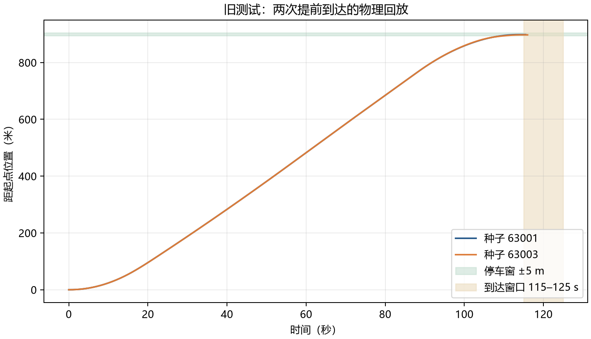
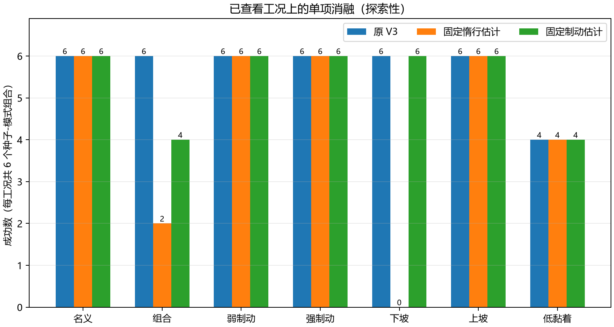

# 面向列车模拟系统的参考轨迹与多目标自动驾驶控制研究

**上海中学杯中学科技创新成果个人项目：研究报告初稿。** 作者、学校、年级、指导教师、本人实际工作与签名均待真实填写；本稿由 Codex 根据已有研究记录辅助整理，须由参赛者核验理解，并依学校要求披露 AI 使用。游戏平台已有开发历史与本次新增研究内容须分别说明。

## 摘要

本研究以 RailwayRenaissance 的简化列车纵向与空气制动模拟器为平台，探究参考轨迹、响应估计和有限候选预测如何影响 900 m 分段限速任务中的停车、时间与控制取舍。冻结 V2 控制器作为对照，研究版 V3 使用全程速度参考、可观测响应估计和三种目标评分。第一组预先冻结测试包含 3 个种子、3 类工况、3 种模式和 2 种控制器，每个组合重复 2 次，共 108 次运行。V3 平稳、省气、准点模式分别在 9 个种子—工况组合中成功 9、7、9 个；省气两次提前到达。后续在 2 个新种子和 7 组工况上开展敏感性和消融探索，并对已查看工况分别固定惰行估计和制动估计。实验表明这些方法的效果依赖模拟工况；关闭惰行估计时下坡工况出现失败。以上不证明实车性能、普遍节气或形式化安全，且不将重复执行计为独立样本。

**关键词：** 列车模拟；参考轨迹；自动驾驶；模型失配；对照实验

## 1. 问题与研究假设

在列车模拟任务中，控制器既要满足分段限速与停车要求，也可能需要兼顾平稳、省气和准点。参考曲线采用简化运动学，而游戏物理内核包含空气压力变化和动力响应，因此参考曲线到达时间不等于实际运行时间。

研究问题：在相同路线、起点和观察权限下，参考轨迹与响应估计能否改善模拟任务中的到站表现？三种目标的表现如何随制动、坡度与黏着变化而改变？

- H1：在指定模型失配工况中，V3 与 V2 的成功、干预或限速表现可能不同。
- H2：三种目标在排气代理、jerk 与控制切换上可能存在取舍，不能预设一种模式全面最优。
- H3：简化轨迹与模拟车辆响应之间的差异可能造成提前到达、晚点或干预。

上述是假设，不是先验事实；研究记录保留相反和失败结果。

## 2. 模型和控制方法

使用已有 50 Hz 简化纵向与空气制动内核，不宣称其参数准确反映现实列车。任务距离 900 m：0–250 m 限速 12 m/s，250–650 m 限速 18 m/s，650–900 m 限速 10 m/s；目标首次到达时刻为 120±5 s。到达以进入目标 ±5 m 且速度低于 0.01 m/s 的首次时刻记录；另外固定 100 个物理 Tick 的停稳确认，不以等待确认来改变到达时刻。

V3 在 1 m 网格上建立前向加速和反向减速速度包络，积分得出参考时间，再以二分搜索选择巡航速度。三种目标从 9 组候选参考参数中选择曲线；控制器每 5 个物理 Tick 根据位置、速度、加速度、压力及已接受命令估计响应，预测有限候选动作与 0.75、1.0、1.25 三种响应倍率。预测不满足约束时，动作被筛除；无可行候选时请求零牵引、常用全制动并退出自动运行。平稳、省气、准点模式的目标评分不同，但限速和停车要求一致。

速度包络、二分搜索、指数平滑和预测控制均是已有方法。本研究的工作重点是将这些方法用于特定模拟器，构造可重复对照并分析失配；有限情景筛查不构成对所有扰动的安全证明，也不等同于文献中的形式化安全滤波。

## 3. 实验设计

第一组冻结测试采用种子 63001–63003 和名义、较重弱制动低黏着下坡、运行中变化三类工况；V2 自适应和 V3 获得相同任务及观测权限，每模式每组合重复两次。事先保存源码哈希、任务、种子、工况及指标，结果保留初始状态、命令、终态与失败。判定成功需首次到达 115–125 s、停车误差绝对值不超过 5 m、无干预且无实际速度超过当前限速 0.15 m/s 的 Tick；0.15 m/s 是实验报告容差，不是铁路标准。

后续探索使用种子 64001/64002，比较 7 组工况，并在隔离副本中进行联合消融和共用参考实验。再对已查看的相同工况分别关闭惰行估计和制动估计；后者不是未知测试。各组重复两次用于检查确定性，重复运行不作为独立样本。

## 4. 结果

| 第一组控制器 | 平稳成功 | 省气成功 | 准点成功 | 三模式的超限速工况数 |
|---|---:|---:|---:|---|
| V2 自适应 | 0/9 | 0/9 | 9/9 | 4、3、0 |
| V3 | 9/9 | 7/9 | 9/9 | 0、0、0 |

九个组合来自三个种子在三个工况上的配对，不可当作九个独立同分布样本。V3 省气失败的两个组合分别在 113.9 s 和 114.5 s 到达，属于提前到达。下图按保存的接受命令重放物理状态；曲线为每 0.5 s 采样，不是新的控制器测试。

在 V3 省气和平稳模式均成功的 7 个配对工况中，省气的排气代理量 7/7 较低；与准点模式比较则为 4/7。样本较小，不能推广为普遍节气。排气代理与燃油分别保存，不换算为真实综合能耗。

对已查看工况的单项消融中，固定惰行估计时单独下坡的成功数为 0/6，原 V3 为 6/6；固定制动估计时弱制动、低黏着、下坡组合为 4/6，原 V3 为 6/6。制动增益估计依赖惰行估计，因此固定惰行也会间接影响制动估计。图 2 中每组 6 个组合来自 2 个种子和 3 种模式，并非 6 个独立受试者。

后续探索基线准点模式在低黏着下两次晚到，分别为 126.4 s 和 126.6 s。第一轮探索的 252 条记录以冻结源码重跑，终态及命令序列指纹逐条一致；单项消融的每组合两次重复也一致。原始数据与统计方式见 [实验记录](ato_v3_results.md) 和 [后续分析](ato_v3_followup_analysis.md)。

## 5. 讨论与结论

在本次模拟条件下，V3 的不同目标产生不同结果，参考—实际差异与早到、晚到现象同时存在；探索性消融提示响应估计对下坡及组合工况的结果有影响。实验也发现 V3 并未全面通过：省气模式有提前到达，低黏着下准点模式有晚到。由于样本较少、模型参数未按实车校准、工况覆盖有限，不能据此断言 V3 普遍优于 V2，也不能推断实车节能或安全。

下一步应扩大预先冻结的工况和独立种子，分离估计器之间的耦合，并以真实数据校准模型后再讨论现实应用。当前 V3 保留为研究场景可选方案，V2 保持默认。

## 6. 工作分工与资料

既有游戏和模拟内核属于项目此前工作；本研究 V3、实验和报告形成于 2026 年 10 月。Codex 辅助方案分析、代码、测试、绘图和文稿整理。参赛学生本人提出、操作、复算、分析和修改的具体内容：**待本人据实填写**；指导教师具体贡献：**待据实填写**。系统原创声明需由参赛者阅读并按实际情况和赛事规则确认。

参考资料：

1. Wabersich, K. P.; Zeilinger, M. N. *A predictive safety filter for learning-based control of constrained nonlinear dynamical systems*. [arXiv:1812.05506](https://arxiv.org/abs/1812.05506). 本项目仅借鉴约束预测的研究背景，不具备该文的形式化保证。
2. 本项目冻结源码和数据：`research/ato-v3/runs/20261028T121643698Z/` 与 `research/ato-v3/followup/runs/20261028T233032799050Z/`。
3. [上海市世外中学公开的 2026 年同赛事通知](https://www.wflms.cn/site/site1/detail/10001ca_b0e353d0-3034-4e67-a66c-871666e9fb6f.html) 和 [区级申报系统使用手册](https://www.wflms.cn/oss/6e/6edf7a2f-7b18-4e11-ab23-16d1466df459/6edf7a2f-7b18-4e11-ab23-16d1466df459.htm)；报名和截止以本人学校通知为准。
